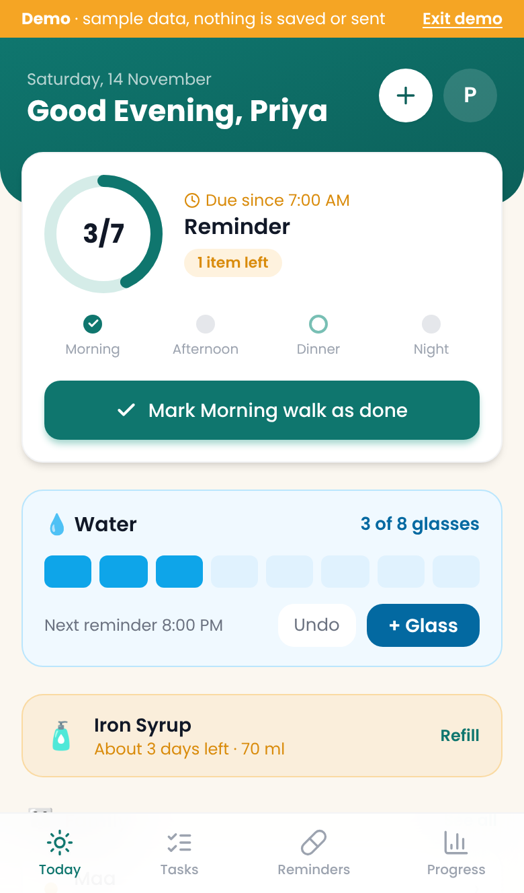
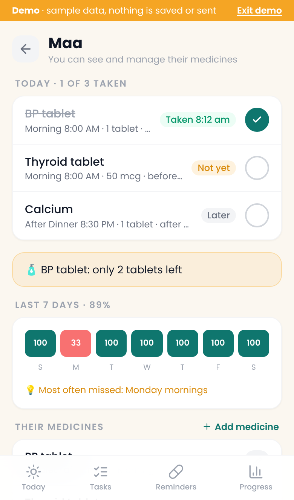
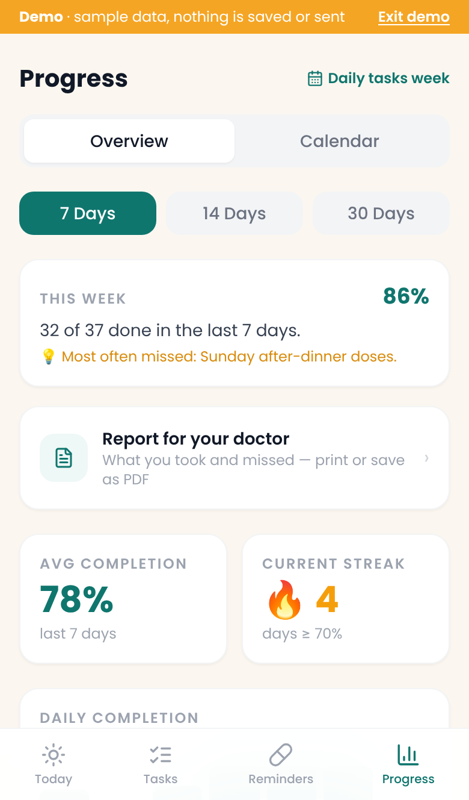
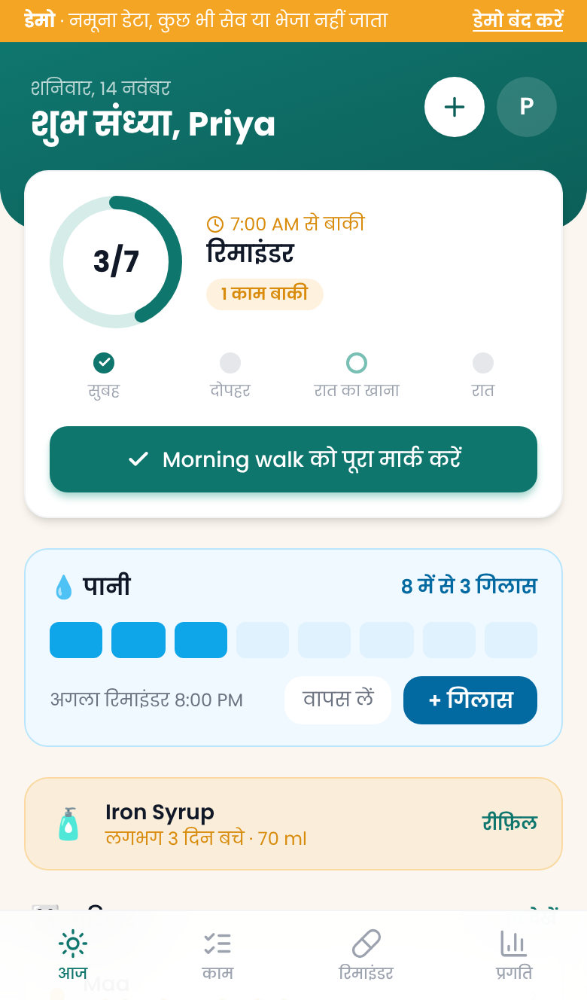
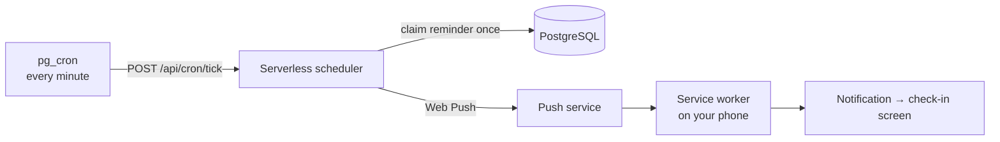

# Daily Assistant

**A free web app for medicine and routine reminders, in English, हिन्दी and ગુજરાતી.**
It reminds you at the times you set, tracks what you took, warns before a medicine runs out, and lets family follow a parent's medicines.

**[▶ Try the live demo](https://daily-assistant-eta.vercel.app)** · tap **"Try the demo"**: no sign-up, sample data, nothing is saved or sent.

<p align="center">
  
</p>
<p align="center"><b><a href="docs/tour.mp4">▶ Watch the full 75-second tour</a></b> (every screen, plus Hindi and Gujarati)</p>

| Today | Family | Progress | हिन्दी |
|---|---|---|---|
|  |  |  |  |

---

## Why I built it
Remembering medicines is hard when the day gets busy, and harder for older parents. Most reminder apps are paid, full of ads or confusing. I wanted one simple, free app for medicines, water, habits and daily tasks that a family could use together, on any phone, without an app store.

## What it does
- **Reminders** at Morning, Afternoon, After Dinner and Night (your own times) or an exact time; every day, some days, monthly or once.
- **Check in from the notification**, snooze for 10/30/60 minutes, or get reminded again like an alarm until it's ticked.
- **Courses** that stop by themselves ("for 5 days"), **only-when-needed (SOS)** medicines, and **holiday mode**.
- **Stock tracking**: counts down every dose and warns before a medicine runs out; add a refill in one tap.
- **Water reminders** with a daily goal, and a **daily task checklist** with a week view.
- **Progress**: streaks, a Sunday summary ("most often missed: Monday mornings"), fix past days, and a **report for your doctor** (print or PDF).
- **Family**: follow a parent's medicines, get a "not taken yet" alert, and manage their medicines if they allow it.
- **Three languages**: every screen, notification and the doctor report in English, Hindi or Gujarati.
- **Private by design**: no ads, no trackers; delete your account and data any time. It never suggests medicines or doses, it only reminds you of what you entered.

## Tech stack
| Layer | Technology |
|---|---|
| Front end | React 18, TypeScript, Vite, Tailwind CSS, React Router |
| Installable app | PWA (vite-plugin-pwa) with a custom service worker for push notifications |
| Database & auth | Supabase: PostgreSQL with row-level security, email one-time-code login |
| Back end | Vercel serverless functions (Node 22) |
| Scheduler | Supabase `pg_cron` calls the back end every minute |
| Notifications | Web Push with VAPID keys |
| Hosting cost | ₹0 / month (free tiers) |

## How a reminder reaches your phone


## Interesting problems I solved
- **Each reminder goes out exactly once.** Before sending, the scheduler inserts a row keyed by *(user, date, reminder)*. A unique key in the database acts as a lock, so two overlapping runs can never both send. Each run also looks back 5 minutes, so a late or skipped run still delivers.
- **Private, even with family.** Every table has row-level security (`user_id = auth.uid()`), so the database itself only returns your own rows. A family member can see only medicines, only after accepting an invite, and can edit only with the owner's permission. The browser only ever has the public key; the secret key stays on the server.
- **Works offline and on several devices.** The app saves changes locally first and syncs the difference to the server. Dose log IDs are built from reminder + time slot + date, so the same dose ticked on two phones becomes one record, not two.
- **One app for every device.** As a PWA it installs from the browser on Android, iPhone and desktop. Each platform has its own notification rules, so a setup guide walks people through turning them on.
- **Notifications in your language.** The server writes every reminder in the person's chosen language; family alerts use the follower's language. Medicine names are never translated.

## Run it locally
```bash
cd frontend
npm install
cp .env.example .env.local      # add your own Supabase URL and public (anon) key
npm run dev                     # app on http://localhost:5173
npm test && npm run test:api    # schedule and scheduler tests
```
Without a Supabase project you can still explore everything with **Try the demo** on the login screen.
Full back-end setup (database schema, email login, cron job): see [`docs/SETUP-PHASE6.md`](docs/SETUP-PHASE6.md).

## Project structure
```
frontend/
  src/        React app: pages, components, context (auth + data sync), lib, locales (hi, gu)
  api/        Vercel serverless functions: cron tick (scheduler), test push, delete account, health
backend/
  supabase/   Database schema and migrations (tables, row-level security, RPCs, cron job)
docs/         Setup guides, screenshots
```

## Status
Live with invited testers (sign-up is invite-only for now). Built and maintained by [Sakshi Shah](https://sakshishah-dev.github.io/portfolio/).
